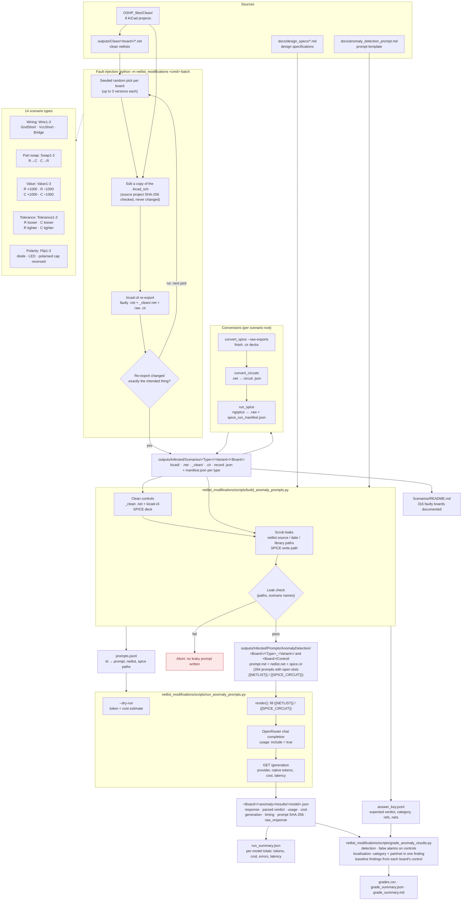

# netlist_modifications

Insert hardware Trojans into KiCad S-expression netlists (`.net`). Self-contained
and dependency-light so it can be reused from other projects: copy the folder,
install `simp_sexp`, and `import netlist_modifications`.

- **Minimal, single-change diffs.** Every Trojan touches only the nets it must,
  leaving the rest of the file (formatting, quoting, header) byte-for-byte intact.
  So a clean-vs-infected diff shows exactly the Trojan and nothing else.
- **Two layers.** A generic engine that records/replays Trojans as JSON *specs*,
  and ready-made rule-based Trojans (snip, swap) built on top of it.

---

## Pipeline overview

The scenario flow, from the clean projects to model results. Fault injection is in
`insert_modification/` and the conversions are in `conversions/`. The benchmark
itself is in `scripts/`:
- `build_anomaly_prompts.py` builds the prompts;
- `run_anomaly_prompts.py` sends them to the models;
- `grade_anomaly_results.py` scores the answers;
- `detect_anomaly_with_design_spec.py` is a one-off check of a single netlist
  against a design spec.

The prompt and the run and grading options are documented in
`docs/anomaly_detection_prompt.md`.



---

## Requirements & how to run

Depends on [`simp_sexp`](https://pypi.org/project/simp-sexp/) for value parsing.
In this repo it lives in `.venv`. Run the CLI **as a module** (the package uses
relative imports, so a loose-file invocation won't work):

```bash
.venv/bin/python -m netlist_modifications <subcommand> ...
.venv/bin/python -m netlist_modifications --help
```

---

## Layout

```
netlist_modifications/
  insert_modification/
    core.py       # engine: parse / render / extract_spec / apply_spec (the library)
    snip.py       # "snip" Trojan  — split one net (SDA, SCL, MISO, MOSI, ...)
    swap.py       # "swap" Trojan  — cross an RX/TX pair (UART, ...)
    tolerance.py  # "tolerance" Trojan — re-grade one R/C/L passive
    value.py      # "value" Trojan — shift one R/C/L passive's SI-prefix magnitude
    gnd_short.py  # "gnd-short" Trojan — tie a labelled net to GND in the .kicad_sch (kicad-cli)
    gnd_short_ref.py # "gnd-short-ref" Trojan — tie a component PIN (e.g. C1) to GND in the .kicad_sch (kicad-cli)
    gnd_short_random.py # "gnd/vcc-short-random" Trojans — N variants, each tying ONE random net to GND or a +rail (kicad-cli)
    bridge_random.py # "bridge-random" Trojan — N variants, each ONE wire between pins of two random components (kicad-cli)
    polarity_flip_random.py # "polarity-flip-random" Trojan — N variants, each ONE random diode / LED / polarised cap reversed (rotated 180°) in the .kicad_sch (kicad-cli)
    tolerance_random.py # "r-/c-tolerance-random" Trojans — N variants, each ONE random resistor (capacitor) given a looser (higher %) Tolerance in the .kicad_sch (kicad-cli)
    magnitude_random.py # "r-/c-magnitude-random" and "r-/c-magnitude-down-random" Trojans — N variants, each ONE random resistor's (capacitor's) value moved up (or down) one SI step in the .kicad_sch (kicad-cli)
    passive_swap_random.py # "r-to-c-random" / "c-to-r-random" Trojans — N variants, each ONE random resistor (capacitor) replaced by a capacitor (resistor) (kicad-cli)
    cli.py        # command-line front end (argparse)
  conversions/
    convert_circuits.py  # infected .net -> hierarchical circuit JSON (needs pcb_qa)
    convert_spice.py     # infected .net -> infected SPICE .cir (needs pcb_qa)
    run_spice.py         # batch-run ngspice over generated .cir files
  scripts/
    build_anomaly_prompts.py           # scenarios + design specs -> anomaly-detection prompts (+ answer key)
    run_anomaly_prompts.py             # send prompts to OpenRouter models, save answers + usage/cost
    grade_anomaly_results.py           # score answers against the answer key
    detect_anomaly_with_design_spec.py # one-off: check one netlist against one design spec
  gen_trojan_questions.py  # Trojan-detection question banks from batch manifests
  __main__.py              # enables `python -m netlist_modifications`
  specs/                   # example Trojan spec(s): uart.json
```

---

## Which Trojan do I want?

| Trojan | What it does | Command | Spec file? |
|---|---|---|---|
| **snip** | Split one bus net into `Troj_<SIGNAL>0` / `Troj_<SIGNAL>1` (cut a trace) | `snip`, `snip-batch` | no — rule-based |
| **swap** | Cross a matched RX/TX pair → `Troj_RX` / `Troj_TX` | `swap`, `swap-batch` | no — rule-based |
| **tolerance** | Re-grade one R/C/L passive to a different tolerance (%) | `tolerance`, `tolerance-batch` | no — rule-based |
| **value** | Shift one R/C/L passive's value to a different SI decade | `value`, `value-batch` | no — rule-based |
| **gnd-short** | Tie a labelled net to GND **in the schematic** (label + wire + GND symbol), re-export with kicad-cli | `gnd-short`, `gnd-short-batch` | no — rule-based |
| **gnd-short-ref** | Tie a component **pin** (e.g. `C1`) to GND **in the schematic** by dropping a GND symbol on the pin; reaches unlabelled/power nets too | `gnd-short-ref`, `gnd-short-ref-batch` | no — rule-based |
| **spec replay** | Reproduce/retarget an *exact* recorded Trojan | `extract`, `apply` | yes — `specs/*.json` |

**Rule-based** Trojans (snip, swap, tolerance, value) compute what to change
from whatever nets/components a board actually has — nothing is stored.
**Spec-based** Trojans capture a specific hand-made example once (via `extract`)
and replay it (via `apply`); that recipe *is* the JSON in `specs/`.

---

## Rule-based Trojans

### snip — cut one bus net in two

Splits a signal net into two nets: the first node is isolated on
`Troj_<SIGNAL>0`, the rest go on `Troj_<SIGNAL>1`.

```bash
# one file
.venv/bin/python -m netlist_modifications snip board.net --signal SDA
.venv/bin/python -m netlist_modifications snip board.net --signal SDA --list        # show candidates
.venv/bin/python -m netlist_modifications snip board.net --signal SDA --net NFC_SDA -o out.net

# every matching net across a tree of clean netlists (one output per net)
.venv/bin/python -m netlist_modifications snip-batch --signal SCL
```

`--signal` is any keyword found in a net name: `SDA`, `SCL`, `MISO`, `MOSI`,
`SCK`, ... A net qualifies if it contains the keyword and has ≥ 2 nodes.

### swap — cross an RX/TX pair (UART)

Swaps the node lists of a matched RX/TX pair and renames them `Troj_RX` /
`Troj_TX`. Pairs are matched by base name, so `UART_RX`↔`UART_TX` and
`UART1_RX_FCC`↔`UART1_TX_FCC` pair up.

```bash
# one file
.venv/bin/python -m netlist_modifications swap board.net --signal UART --list
.venv/bin/python -m netlist_modifications swap board.net --signal UART --net UART_RX -o out.net

# every RX/TX pair across a tree (one output per pair)
.venv/bin/python -m netlist_modifications swap-batch --signal UART
```

Works for any RX/TX-named bus (e.g. `--signal RS485`), not just UART.

### tolerance — re-grade a passive (R/C/L) to a different tolerance

Models a supply-chain substitution: a resistor/capacitor/inductor is swapped
for a same-value, same-footprint part sourced to a **different tolerance
grade**. Value, footprint and every net stay untouched — the only change is a
single `Tolerance` property in the component's own `(comp ...)` block, so the
diff is one line. The new grade is picked deterministically (hash of board +
ref), never equal to the component's current grade.

"Current grade" is read with this precedence: an explicit `Tolerance`
property already in the block > a grade mined from the vendor part/description
text when the library states one (e.g. `"RES 10kΩ ±1% 1/8W 0805 Yageo"`) > a
generic per-family default (5% for R, 10% for C/L) when the netlist states
neither — so the *value that gets tampered* is always the board's real
declared tolerance where one exists, and after the swap it visibly disagrees
with any untouched vendor description sitting right next to it.

```bash
# one file
.venv/bin/python -m netlist_modifications tolerance board.net --list           # show candidates + current grade
.venv/bin/python -m netlist_modifications tolerance board.net --ref R5 -o out.net

# every R/C/L passive across a tree of clean netlists (one output per part)
.venv/bin/python -m netlist_modifications tolerance-batch
.venv/bin/python -m netlist_modifications tolerance-batch --families R,C       # skip inductors
```

Only two-terminal passives with a meaningful ±% rating qualify: Device-library
`R`/`R_Small`/`R_US`/`C`/`C_Small`/`C_Polarized`/`L`, plus any part whose
libsource `part` text starts with `RES`/`CAP`/`IND` (vendor-exported
libraries). LEDs, diodes, transistors, crystals and fuses are excluded — they
aren't rated by a simple tolerance percentage.

### value — shift a passive's magnitude (same unit, different decade)

Tampers with the component's actual nominal value instead of a bolted-on
property: it shifts the SI-prefix magnitude (p, n, u, m, k, M) while leaving
every digit, the decimal point, and the base unit (ohms/farads/henries)
untouched. A `10k` pull-up silently becomes `10M`; a `100n` decoupling cap
becomes `100u`; a bare `47` (ohm) resistor becomes `47k`. Same-family,
same-footprint, same-digits — only the decade is wrong, which is exactly the
kind of misread (k vs M, m vs M) that slips past a schematic review.

```bash
# one file
.venv/bin/python -m netlist_modifications value board.net --list           # show candidates + current value
.venv/bin/python -m netlist_modifications value board.net --ref C5 -o out.net

# every R/C/L passive across a tree of clean netlists (one output per part)
.venv/bin/python -m netlist_modifications value-batch
.venv/bin/python -m netlist_modifications value-batch --families R          # resistors only
```

Handles every value shape seen in this corpus: plain SI shorthand (`10k`,
`3.9uH`), KiCad's decimal-in-letter form (`4k7` = 4.7k, `2u2` = 2.2u), and
bare/no-prefix numbers with or without a spelled-out unit (`47`, `100R`,
`0.47ohm`, `100Ω`). A trailing rating/tolerance/description (`47uF 63V
solid`, `1nF 2kV`, `2.2k 1%`, `0.1uF/16V`) is split off first and left
alone, so a prefix letter inside a voltage rating (the `k` in `2kV`) is
never mistaken for the component's own magnitude. A value with no
meaningful magnitude to shift — a 0-ohm link, or a placeholder like `??` —
is skipped rather than corrupted.

### Batch output layout

`snip-batch`, `swap-batch`, `tolerance-batch` and `value-batch` write **one
output file per net / per pair / per part**, so each output's diff is a
single change:

```
<out-root>/<board>/<net-or-pair-or-ref>/<original filename>
<out-root>/manifest.json          # board, target(s), output path, what changed
```

Defaults: `--clean-glob 'outputs/Clean/*/*.net'`, `--out-root
outputs/Infected/<SIGNAL>` (snip/swap), `outputs/Infected/Tolerance`
(tolerance-batch), or `outputs/Infected/Value` (value-batch). Override either
for use outside this repo.

### gnd-short — tie a net to GND in the schematic (kicad-cli)

The only Trojan that edits the **design source** rather than an exported
`.net`. It edits the `.kicad_sch` (the `.kicad_pro` holds settings, not
connectivity, and is just copied alongside) and lets `kicad-cli` produce the
infected netlist. On the sheet carrying the target label it appends, in free
space right of the existing drawing:

```
<label "NET">  --wire--  <GND power symbol>
```

The label is a clone of the existing one (same local/global/hierarchical
kind, so it joins the net by name) and the GND symbol is a clone of one
already on that sheet (right lib_id, instance paths, project name), with
fresh UUIDs and an unused `#PWR9xxx` ref. Nothing else in the file changes,
so the `.kicad_sch` diff is purely additive.

```bash
# one project (pass the root .kicad_sch or the .kicad_pro)
.venv/bin/python -m netlist_modifications gnd-short OSHP_files/Clean/stack-chan/schematics/m5-pantilt/m5-pantilt.kicad_pro --list
.venv/bin/python -m netlist_modifications gnd-short OSHP_files/Clean/stack-chan/schematics/m5-pantilt/m5-pantilt.kicad_pro --label TXD2 --erc

# every labelled net matching a keyword, across the designs behind outputs/Clean
.venv/bin/python -m netlist_modifications gnd-short-batch --signal SDA [--erc]
```

The batch finds each board's schematic from the clean `.net`'s `(source ...)`
header, remapped onto `OSHP_files/Clean/`. Output per variant:

```
<out-root>/<board>/_clean/<name>.net        # clean design re-exported by the same kicad-cli
<out-root>/<board>/<net>/kicad/...          # infected project copy (.kicad_pro + sheets + lib tables)
<out-root>/<board>/<net>/<name>.net         # infected netlist (kicad-cli export)
<out-root>/manifest.json
```

Ground truth is measured, not assumed: each manifest entry records
`victim_nets`, the `moved_nodes` (pins that ended up on GND's net) and
`merged_net`, the name KiCad gave the merged net. That name is `GND` when the
label is local, but a **global label's name wins over the power symbol**, so
shorting a global net renames the whole GND net (e.g. `SDA6`). Variants
where no pins move, or where the same pins already moved under another label
(e.g. local `/SDA6` and global `SDA6` on one net), are dropped. `--erc` adds
clean/infected ERC counts; the tell-tale new warning is `multiple_net_names`.

Limits: only nets that carry a label (unnamed `Net-(R1-Pad2)` nets are not
targeted), only sheets that already have a GND symbol to clone, bus labels
skipped, and KiCad 6+ schematics only. Legacy `.sch`/`.pro` projects
(HadesFCS) must be opened and saved in KiCad first. kicad-cli is found via
`$KICAD_CLI_PATH`, then `PATH`, then the macOS app bundle.

### gnd-short-ref — tie a component pin to GND in the schematic (kicad-cli)

Like `gnd-short`, this edits the **design source** and re-exports with
kicad-cli, but it targets a component **pin** (default `C1`) instead of a net
*label* — so it reaches nets that have no label at all: power rails (`VCC`,
`+5V`), auto-named nets (`Net-(D2-K)`), anything. It finds the symbol on
whichever sheet carries it (root **or** sub-sheet), works out where the chosen
pin physically connects on that sheet, and drops a clone of that sheet's own
GND power symbol so the clone's pin lands exactly on the target pin. KiCad
connects items by coincident points, so **no wire is drawn** — the
clean-vs-infected `.kicad_sch` diff is a single added GND symbol.

By default it shorts the pin that is **not already on GND** (a decoupling cap
usually has one pin grounded already); `--pin` forces a specific pin.

```bash
# one project (pass the root .kicad_sch or the .kicad_pro)
.venv/bin/python -m netlist_modifications gnd-short-ref OSHP_files/Clean/MyKiCad/Atmel/fan_controller/fan_controller.kicad_sch
.venv/bin/python -m netlist_modifications gnd-short-ref OSHP_files/Clean/portal-hardware/PCB.kicad_pro --ref C2 --pin 1 --erc

# the same pin on every clean design under outputs/Clean
.venv/bin/python -m netlist_modifications gnd-short-ref-batch --ref C1 [--erc]
```

Output per board (default `--out-root outputs/Infected/GndShortRef/<REF>`):

```
<out-root>/<board>/_clean/<name>.net        # clean design re-exported by the same kicad-cli
<out-root>/<board>/kicad/...                # infected project copy (only the target sheet differs)
<out-root>/<board>/<name>.net               # infected netlist (kicad-cli export)
<out-root>/<board>/gnd_short_ref.json       # (single runs) this variant's record
<out-root>/manifest.json
```

Ground truth is measured, not assumed: each manifest entry records the
`ref`/`ref_pin` shorted, the `sheet` edited, `victim_nets`, `moved_nodes` (every
pin that ended up on GND's net) and `merged_net` (the name KiCad gave the merged
net — often the rail's name, e.g. `+5V`, rather than `GND`). The run fails and
discards the output if the target pin did **not** actually move onto GND, so a
geometry error can't produce a mislabelled sample.

The **original project is never modified**: everything is built from a copy, and
the whole source tree is SHA-256-hashed before and after — any accidental write
aborts the run.

Limits: the target's sheet must carry a GND symbol to clone, and the sheet must
be instantiated **exactly once**. A part on a *reused* sheet is refused with its
reason (editing the one shared symbol would short every instance, not just the
one asked for — e.g. `C1`, which is also `C26`/`C120` elsewhere on
AcornRobotElectronics). KiCad 6+ schematics only; kicad-cli resolution and the
legacy-project caveat are the same as `gnd-short` above.


### gnd-short-random / vcc-short-random — one random net tied to GND or a +rail per variant (kicad-cli)

Same placement as `gnd-short-ref` (a GND clone dropped on a component pin), but
the target is chosen at random: for each clean design it picks `--count`
(default 3) **distinct** nets, excluding GND-like and `unconnected-` nets, and on
each one a random visible pin of a single-instance sheet. Every variant holds
exactly **one** modification. The picks are seeded (`--seed`, combined with the
board name), so a re-run reproduces them.

```bash
.venv/bin/python -m netlist_modifications gnd-short-random-batch [--count 3] [--seed 0]
.venv/bin/python -m netlist_modifications.conversions.convert_spice --raw-exports --root outputs/Infected/GndShortRandom
.venv/bin/python -m netlist_modifications.conversions.convert_circuits --root outputs/Infected/GndShortRandom
.venv/bin/python -m netlist_modifications.conversions.run_spice --root outputs/Infected/GndShortRandom
```

```
<out-root>/Wire<i>/<board>/_clean/<name>.net     # clean kicad-cli re-export
<out-root>/Wire<i>/<board>/kicad/...             # modified project copy (one sheet differs)
<out-root>/Wire<i>/<board>/<name>.net / .cir     # modified netlist / SPICE export
<out-root>/Wire<i>/<board>/gnd_short_random.json # this variant's record
<out-root>/Wire<i>/manifest.json, <out-root>/manifest.json
```

Each record names the shorted `net`, the `ref`/`ref_pin` the GND symbol sits on,
the `sheet` edited, the `gnd_refs` added, and the measured `moved_nodes` and
`merged_net`. A pick is kept only if the pins that moved onto GND are
**exactly** that net's pins. Otherwise it is discarded and the next random
pick is tried. The run refuses to overwrite an existing `<out-root>/Wire<i>/<board>`.

`vcc-short-random-batch` is the same with a positive rail in place of GND
(default out-root `outputs/Infected/VccShortRandom`, record
`vcc_short_random.json`). The clone is one of the sheet's positive-rail power
symbols (`VCC`, `+3V3`, `+5V`, `VBUS`, ...). `VCC` is preferred, else the rail
with the most pins. Positive rails are not themselves picked as victims, since
tying `+3.3V` to `+3V3` is often a no-op. Each record's `rail` says which
supply was used.

A global label's name beats a power symbol's, so the merged net is often
renamed after the victim (e.g. `+3V3` becomes `ADC3_0_FCC`). `convert_spice
--raw-exports` detects this from the variant's `.net` vs `_clean/` and maps the
node back to the rail (or `0`), so the rail stays driven. See `renamed` in
`spice_manifest.json`.


### bridge-random — one wire between two random components per variant (kicad-cli)

Draws a single `(wire ...)` on one sheet, from a visible pin of one component to
a visible pin of a **different** component on a different net, so the two nets
merge. Both nets must be signal nets: GND-like, positive-rail and `unconnected-`
nets are excluded, since bridges to those are the GND/VCC scenarios above. A
design's variants use pairwise-distinct nets.

```bash
.venv/bin/python -m netlist_modifications bridge-random-batch [--count 3] [--seed 0]
```

Same layout and conversions as `gnd-short-random`, under
`outputs/Infected/BridgeRandom`, with `bridge_random.json` per variant. Each
record holds `ref_a`/`pin_a`/`net_a`, `ref_b`/`pin_b`/`net_b`, the `sheet`,
the wire's `wire_from`/`wire_to` coordinates and the resulting `merged_net`. A
pick is kept only if exactly those two nets merged and every other net is
unchanged. That also rejects a wire whose straight path runs over another pin
or wire end.


### r-to-c-random — one resistor replaced by a capacitor per variant (kicad-cli)

Picks `--count` distinct two-pin `R<n>` resistors on single-instance sheets
and, in each variant, rewrites one of them in place as a capacitor cloned from
one of the board's own `C<n>` parts: lib symbol, `Value`, `Footprint` and every
property both share. Resistor-only properties (`Sim.*`, `MPN`, ...) are
dropped. The new part takes the next free `C<n>` reference, which is also what
makes kicad-cli's SPICE export emit a `C` element. Templates with a numeric
value are preferred, then non-polarised ones.

The capacitor is rotated so its pin 1 → pin 2 axis matches the resistor's, with
pin 1 on the resistor's pin 1. Where the pin spacings differ (OPNhydro-r2's
Coert-Vonk symbols, AcornRobot's `TAYLOR_RESISTOR`), one collinear wire joins
the capacitor's pin 2 to the resistor's old pin 2.

```bash
.venv/bin/python -m netlist_modifications r-to-c-random-batch [--count 3] [--seed 0]
.venv/bin/python -m netlist_modifications.conversions.convert_spice --raw-exports --root outputs/Infected/Scenarios/ResistorToCapacitorRandom
.venv/bin/python -m netlist_modifications.conversions.convert_circuits --root outputs/Infected/Scenarios/ResistorToCapacitorRandom
.venv/bin/python -m netlist_modifications.conversions.run_spice --root outputs/Infected/Scenarios/ResistorToCapacitorRandom
```

Same layout as `gnd-short-random`, but under `Swap<i>/<board>` and with
`r_to_c_random.json` per variant. Each record holds the removed `ref` /
`old_value` / `old_footprint` / `old_part`, the new `new_ref` / `new_value` /
`new_footprint` / `template_part`, the `template_ref` it was cloned from, the
pin-by-pin `clean_pin_nets` / `pin_nets`, and `wire_added`. A pick is kept only
if the re-export has the resistor gone, the capacitor on exactly its nets pin
for pin with the template's library part, and every other component and net
unchanged (`exact`).

A capacitor in place of a DC path can leave a node with no DC route to ground,
which ngspice rejects ("timestep too small"). Such decks run once
`.option rshunt=1e12` is added. The pipeline doesn't add it.

`c-to-r-random-batch` is the mirror image: a random two-pin `C<n>` becomes a
resistor cloned from one of the board's `R<n>` parts, under the next free
`R<n>` (default out-root `outputs/Infected/Scenarios/CapacitorToResistorRandom`,
record `c_to_r_random.json`). Resistor templates with a numeric, non-zero value
are preferred, so the swap is never really a 0 Ω jumper. Records also carry
`old_polarised` for the removed capacitor. Both modes live in
`passive_swap_random.py` and share one seed scheme, so a re-run reproduces the
picks.

```bash
.venv/bin/python -m netlist_modifications c-to-r-random-batch [--count 3] [--seed 0]
```


### r-magnitude-random — one resistor's value 1000x larger per variant (kicad-cli)

The schematic-level, random counterpart of `value`. In each variant, one random
two-pin `R<n>` on a single-instance sheet has only its `Value` property moved up
one SI step (`m` → none → `k` → `M`), with `value`'s token parser keeping
digits, unit and trailing ratings: `10k` → `10M`, `470` → `470k`,
`4k7` → `4M7`, `110m` → `110`. 0-ohm links, unparseable values (`??`) and
values already in `M` are skipped.

```bash
.venv/bin/python -m netlist_modifications r-magnitude-random-batch [--count 3] [--seed 0]
```

Same layout and conversions as `gnd-short-random`, under
`outputs/Infected/Scenarios/ResistorMagnitudeUpRandom/Value<i>/<board>`, with
`r_magnitude_random.json` per variant (`ref`, `old_value`, `new_value`,
`old_prefix`, `new_prefix`, `factor`, `pin_nets`, `exported_value`). A pick is
kept only if the re-export changes exactly that component's value and nothing
else (`exact`). kicad-cli's SPICE export writes `M` as `Meg`, so ngspice sees
mega-ohms, not milli-ohms.

`c-magnitude-random-batch` is the same for two-pin `C<n>` capacitors, stepping
`p` → `n` → `u` → `m` (`100n` → `100u`, `1uF 25V` → `1mF 25V`). Values
with no prefix (an ambiguous bare farad) or already in `m` are skipped. The
default out-root is `outputs/Infected/Scenarios/CapacitorMagnitudeUpRandom`,
with `c_magnitude_random.json` per variant. Both modes live in
`magnitude_random.py`.

```bash
.venv/bin/python -m netlist_modifications c-magnitude-random-batch [--count 3] [--seed 0]
```

`r-magnitude-down-random-batch` steps a resistor *down* one SI step instead
(`M` → `k` → none → `m`, `factor` 0.001): `10k` → `10`, `2k2` → `2R2`,
`470` → `470m`. Values already in `m` are skipped. The default out-root is
`outputs/Infected/Scenarios/ResistorMagnitudeDownRandom`, with
`r_magnitude_down_random.json` per variant.

```bash
.venv/bin/python -m netlist_modifications r-magnitude-down-random-batch [--count 3] [--seed 0]
```

`c-magnitude-down-random-batch` is the same for capacitors (`m` → `u` → `n`
→ `p`, `factor` 0.001): `100n` → `100p`, `1uF/25V` → `1nF/25V`. Values with no
prefix or already in `p` are skipped. The default out-root is
`outputs/Infected/Scenarios/CapacitorMagnitudeDownRandom`, with
`c_magnitude_down_random.json` per variant.

```bash
.venv/bin/python -m netlist_modifications c-magnitude-down-random-batch [--count 3] [--seed 0]
```


### r-tolerance-random — one resistor at a looser tolerance per variant (kicad-cli)

The schematic-level, random counterpart of `tolerance`. In each variant, one
random two-pin `R<n>` on a single-instance sheet is given a strictly looser
grade from `tolerance.TOLERANCE_GRADES["R"]`. Its current grade comes from,
in order: a `Tolerance` property, a `N%` in `Value`, a `±N%` in the lib symbol
name or any property, else `tolerance.BASELINE_TOLERANCE["R"]` (5%).

The edit sets a hidden `Tolerance` property (added if missing, cloned from the
block's `Datasheet` property) and rewrites every `N%` / `±N%` stating the old
grade in `Value` or another property (not `Datasheet`, whose URLs carry
`%`-escapes). A grade inside the lib symbol name is left alone and listed in
`stale_mentions`. 0-ohm links, `??` values and resistors already at 20% are
skipped.

```bash
.venv/bin/python -m netlist_modifications r-tolerance-random-batch [--count 3] [--seed 0]
```

Same conversions as the others, under
`outputs/Infected/Scenarios/ResistorToleranceUpRandom/Tolerance<i>/<board>`,
with `r_tolerance_random.json` per variant (`baseline_tolerance`,
`baseline_source`, `substituted_tolerance`, `restated_in`, `stale_mentions`,
`exported_tolerance`, ...). A pick is kept only if the re-export leaves every
net and every other component byte-identical and the resistor carries the new
`Tolerance` field (`exact`).

`c-tolerance-random-batch` is the same for two-pin `C<n>` capacitors, with
`tolerance.TOLERANCE_GRADES["C"]` (1/5/10/20%) and the capacitor baseline (10%).
The default out-root is `outputs/Infected/Scenarios/CapacitorToleranceUpRandom`,
with `c_tolerance_random.json` per variant. With a 10% baseline the only looser
grade is 20%, so most picks are 10% → 20%. Both modes live in
`tolerance_random.py`.

```bash
.venv/bin/python -m netlist_modifications c-tolerance-random-batch [--count 3] [--seed 0]
```

`r-tolerance-down-random-batch` swaps a resistor for a *tighter* grade instead
(a strictly lower ±%, e.g. 5% → 1% or 0.1%). It's a spec/BOM mismatch rather
than a functional risk. The default out-root is
`outputs/Infected/Scenarios/ResistorToleranceDownRandom`, with
`r_tolerance_down_random.json` per variant. `c-tolerance-down-random-batch`
does the same for capacitors (1/5/10/20%, so from the 10% baseline to 5% or 1%),
into `CapacitorToleranceDownRandom` with `c_tolerance_down_random.json`. All four
modes live in `tolerance_random.py` and use independent seeds, so adding one
changes none of the existing picks.

```bash
.venv/bin/python -m netlist_modifications r-tolerance-down-random-batch [--count 3] [--seed 0]
.venv/bin/python -m netlist_modifications c-tolerance-down-random-batch [--count 3] [--seed 0]
```


### polarity-flip-random — one polarised part fitted backwards per variant (kicad-cli)

Reverses one random diode, LED or polarised capacitor by rotating its symbol 180°
about its pins' midpoint. Pin 1 lands exactly on old pin 2 and vice versa, so
the `.kicad_sch` diff is that symbol's `(at ...)`. Bidirectional TVS diodes
(`D_TVS`, `...CA` part numbers) and parts with both pins on one net are skipped,
since a flip would change nothing. A pick is kept only if the re-export shows
the part's two pins swapped nets and nothing else changed (`exact`). Records:
`polarity_flip_random.json` (`ref`, `kind`, `pin_nets`, `flipped_pin_nets`,
`pin_functions`, `old_at`, `new_at`), under
`outputs/Infected/Scenarios/PolarityFlipRandom/Flip<i>/<board>`.

```bash
.venv/bin/python -m netlist_modifications polarity-flip-random-batch [--count 3] [--seed 0]
```

Resistors aren't covered: a resistor has no polarity, so reversing one changes
nothing.

---

## Spec-based Trojans

A **spec** is a JSON list of net-level operations (`modify_net`, `split_net`,
`add_net`, `remove_net`). Use this path when you have a concrete infected example
you want to reproduce exactly, or retarget across boards.

### extract — record a Trojan from a clean/infected pair

```bash
.venv/bin/python -m netlist_modifications extract \
    outputs/Clean/Meshinger/Meshinger.net \
    outputs/Infected/UART/Meshinger/Meshinger.net \
    --label UART --param J7=CONN --param U5=MCU \
    -o netlist_modifications/specs/uart.json
```

`--param OLDREF=VAR` turns a component ref into a `${VAR}` placeholder whose
default is that ref, so the spec stays retargetable. Omit `-o` to print to stdout.

### apply — replay a spec onto a clean netlist

```bash
.venv/bin/python -m netlist_modifications apply \
    outputs/Clean/Meshinger/Meshinger.net \
    netlist_modifications/specs/uart.json \
    -o outputs/Infected/UART/Meshinger/Meshinger.net
```

- `--set NAME=VALUE` overrides a `${VAR}` placeholder (e.g. `--set CONN=J3`). An
  unresolved placeholder is an error, not a silent `${CONN}` in the file.
- `--strict` makes a missing target net (or a node list that doesn't match the
  spec's `expect_nodes`) a hard error instead of a skip.

The bundled `specs/uart.json` reproduces the Meshinger UART sample byte-for-byte
(RX/TX rename + rewire **and** the `+3V3`/`GND`/`Display_Power_Switch` class
downgrades). It's kept as the worked example for this workflow.

---

## Conversions (`netlist_modifications/conversions/`)

Three separate scripts, meant to run in sequence after generating infected
netlists. **Note:** unlike the rest of this package (which only needs
`simp_sexp`), all three depend on the **pcb_qa** project package (`convert_spice`
directly; the others import it lazily) — run them with the project venv, from
the repo root.

### convert_circuits — infected `.net` → hierarchical circuit JSON

Convert each infected netlist to hierarchical circuit JSON, written
`<source>.json` next to every `.net`:

```bash
.venv/bin/python -m netlist_modifications.conversions.convert_circuits                       # whole Infected tree
.venv/bin/python -m netlist_modifications.conversions.convert_circuits --root outputs/Infected/SDA
.venv/bin/python -m netlist_modifications.conversions.convert_circuits --verbose             # show parser logs
```

Re-run it any time you regenerate netlists.

### convert_spice — infected `.net` → infected SPICE `.cir`

For every infected `.net` under
`outputs/Infected/ComponentSubstitution/{Value,Tolerance}/<board>/<ref>/`,
writes a sibling `.cir`, derived from that board's Clean `.cir` template
(`outputs/Clean/<board>/*.cir`) with the same substitution applied — **without**
re-running KiCad's schematic → SPICE export (the infected netlists have no
schematic to export from):

- **Value** substitutions rewrite just the SI-magnitude prefix of the matching
  `.cir` line (`10k` → `10M` in the `.net` becomes `10k` → `10Meg` in the `.cir`,
  since bare SPICE `M` means milli, not mega), reusing the Clean line's own
  already-correct mantissa.
- **Tolerance** substitutions never touch a component's `value`, and KiCad's
  SPICE exporter has no notion of tolerance at all, so the `.cir` is a copy of
  the Clean template — only its `write` output path is retargeted (see below).
- A ref the Clean board's SPICE export excludes (KiCad doesn't model every
  schematic component) is written out unchanged.
- Every variant's own `.control` block is rewritten to `write` its `.raw` dump
  next to its own `.cir`, instead of the Clean template's single shared path —
  otherwise every variant of a board would clobber the same `.raw` file.
- `stack-chan`'s Clean `.cir` was checked in at KiCad's raw, pre-conversion
  export stage (no `.control`/`tran`/`write`/DC sources at all, unlike every
  other board). `convert_spice` finishes it into a runnable deck **in memory**
  before using it as that board's template — it is never written to
  `outputs/Clean/`.

```bash
.venv/bin/python -m netlist_modifications.conversions.convert_spice                       # whole ComponentSubstitution tree
.venv/bin/python -m netlist_modifications.conversions.convert_spice --root outputs/Infected/ComponentSubstitution/Value
.venv/bin/python -m netlist_modifications.conversions.convert_spice --dry-run             # report only, write nothing
```

Writes a manifest to `<root>/spice_manifest.json` (per-file board/ref/status/detail).
Never reads a Clean `.net`/`.cir` for anything other than as an unmodified
template, and never writes under `outputs/Clean/`.

### run_spice — batch-run ngspice over generated `.cir` files

Runs `ngspice -b` against every `.cir` under a root (in parallel), writing an
ngspice log next to each one:

```bash
.venv/bin/python -m netlist_modifications.conversions.run_spice                       # whole ComponentSubstitution tree
.venv/bin/python -m netlist_modifications.conversions.run_spice --root outputs/Infected/ComponentSubstitution/Value
.venv/bin/python -m netlist_modifications.conversions.run_spice --jobs 8              # parallel ngspice processes
```

Only needs the `ngspice` binary on `PATH` (no pcb_qa/venv dependency). Writes a
manifest to `<root>/spice_run_manifest.json` (per-file ok/fail + first error
line). A circuit that doesn't converge under ngspice's default `tran` solver
(e.g. an extreme Value-substitution magnitude shift next to a near-zero-ohm
net tie, which can blow the linear solver's condition number past
double-precision range) needs solver-level fixes by hand — relaxed
`.options` tolerances/`gmin` stepping/`rshunt`, or, if the matrix stays
singular, nudging an adjacent near-zero-value passive slightly off zero — not
something this script attempts automatically.

## Trojan-detection question banks

Generate a detection question bank next to each infected netlist, driven by the
batch `manifest.json` files:

```bash
.venv/bin/python -m netlist_modifications.gen_trojan_questions                 # whole Infected tree
.venv/bin/python -m netlist_modifications.gen_trojan_questions --root outputs/Infected/SDA
```

For each infected variant it writes `<stem>_trojan_questions.json` into that
folder (schema `{category, question, answer, clean_answer}`, `category =
"trojan_detection"`). Each `answer` is the ground truth **on the infected
netlist**, computed from the parsed files, and questions are kept only when the
clean and infected answers differ — so every question is guaranteed to
discriminate. Question kinds:

- a named signal net is now missing (renamed/removed),
- a `Troj_*` net has appeared (canary),
- a signal endpoint moved to the wrong net (RX/TX swap),
- two components that shared a bus net are no longer on a common net (snip),
- a pin now sits on a one-pin (floating) net — dangling pin (snip),
- a pin's function contradicts its net's role, e.g. a `UART_TXD` pin on a
  receive-named net (swap; emitted only when pin functions denote a role).

The last two are reference-free — they flag the tamper from the infected file
alone, even if the `Troj_*` nets were renamed to something innocent.

`clean_answer` is stored alongside so the bank supports single-file scoring or
clean-vs-infected differential scoring. Only manifest-listed variants are
covered (the hand-made `outputs/Infected/UART/Meshinger/Meshinger.net` sample is
not in a manifest, so it is skipped).

## Library use

```python
import netlist_modifications as t

clean = t.read("board.net")

# rule-based, in memory (no spec file needed)
nets = t.parse_nets(clean)
sda  = t.bus_nets(nets, "SDA")[0]
infected, log = t.apply_spec(clean, t.build_split(sda, "SDA"))

rx, tx = t.uart_pairs(nets, "UART")[0]
infected, log = t.apply_spec(clean, t.build_swap(rx, tx))

passives = t.parse_passives(clean)
sub = t.build_substitution(passives[0], clean, board="board")
infected = t.tolerance.apply_tolerance(clean, passives[0], sub["substituted_tolerance"])

candidates = t.parse_candidates(clean)
vsub = t.value.build_substitution(candidates[0], board="board")
infected = t.value.apply_value(clean, candidates[0], vsub["new_value"])

# spec-based
spec = t.extract_spec("clean.net", "infected.net", label="UART")
infected, log = t.apply_spec(clean, spec)

# batch runners
t.snip.run_batch("SDA")
t.swap.run_batch("UART")
t.tolerance.run_batch()
t.value.run_batch()
```

---

## How it works (and why)

- **Join by code, key by name.** `extract` matches clean↔infected nets by KiCad
  *code* (stable between two exports of one schematic), but every op is keyed by
  net *name*, so a spec applies to a freshly regenerated netlist even if codes move.
- **Surgical edits.** `apply` does string-level edits (a rename/class change is
  one header swap; only rewired/split nets have their node block rebuilt). A full
  `simp_sexp` round-trip would reformat the whole file — that's deliberately avoided.
- **Header left alone.** The `(source ...)`/`(date ...)` header is environment
  metadata, not part of the Trojan, so it is never touched.

---

## Notes & limitations

- **Which side of a cut?** A netlist has no trace topology, so "which node goes on
  which side" of a snip is a *choice*. The rule (isolate the first node) lives in
  `snip.build_split`; edit it for a different cut.
- **`swap` ≠ the exact Meshinger sample.** The generalized swap does only the
  RX/TX cross; it omits the class downgrades and uses `Troj_RX` (not the sample's
  uppercase `TROJ_RX`). Use `apply specs/uart.json` for the exact sample.
- **`--set` / `--param` don't validate.** They substitute the ref *string* only;
  they don't check the ref exists on the board. `pin`/`pinfunction` values in a
  spec are literal — parameterise them too, or extract a board-specific spec, if a
  target board's wiring differs.
- **Run with `-m`.** Package-relative imports mean `python -m netlist_modifications ...`,
  not `python netlist_modifications/cli.py`.

---

## Reusing elsewhere

Copy `netlist_modifications/` next to your code (or onto `PYTHONPATH`) and
`pip install simp_sexp`. The snip/swap path defaults are just CLI defaults —
override with `--clean-glob` / `--out-root`, or call `snip.run_batch(...)` /
`swap.run_batch(...)` / `run_single(...)` with your own paths.
