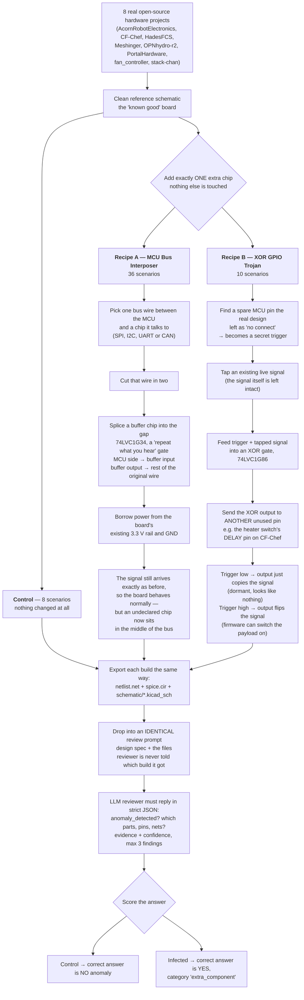

# RQ2 Complex Mods — what happens to the schematics

54 scenarios = 8 Control + 36 MCU Bus Interposer + 10 XOR GPIO Trojan, across 8 projects.
Every infected build adds **exactly one** extra chip and changes nothing else.

## Why the two recipes are hard in different ways

| | Bus Interposer (36) | XOR GPIO Trojan (10) |
|---|---|---|
| Part added | `74LVC1G34` single buffer | `74LVC1G86` single XOR gate |
| Existing nets disturbed | One bus net is split in two | None — only taps and unused pins |
| Visible effect when idle | None (buffer passes signal through) | None (output copies tapped signal) |
| Tell-tale | An IC the spec never mentions, sitting between MCU and peripheral | Two "no connect" pins suddenly in use |

Targeted bus signals across the 36 interposer scenarios: `SCK`, `SDA`, `SCL`, `MOSI`, `MISO`,
`UART_RX/TX` (incl. `UART2`–`UART5`), `RXD2`/`TXD2`, `CAN_SCK`, `SBUS_RX`, `HDMI0_SCL`,
`DISP_SCL/SDA`, `NFC_SCL/SDA`, `SCL_EC`/`SDA_EC`, `I2C1`–`I2C3`.
